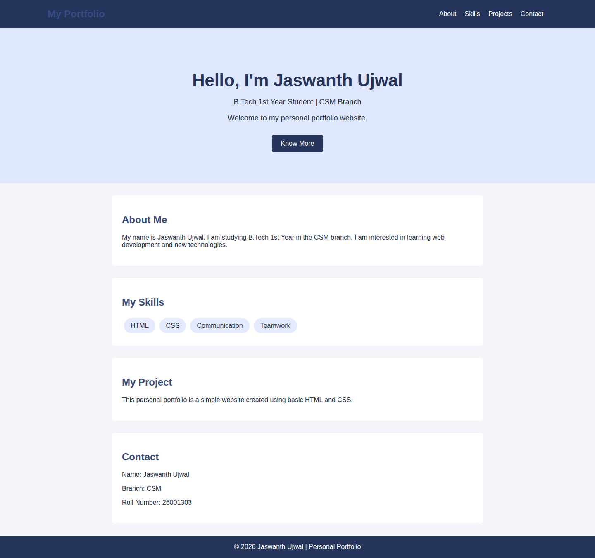
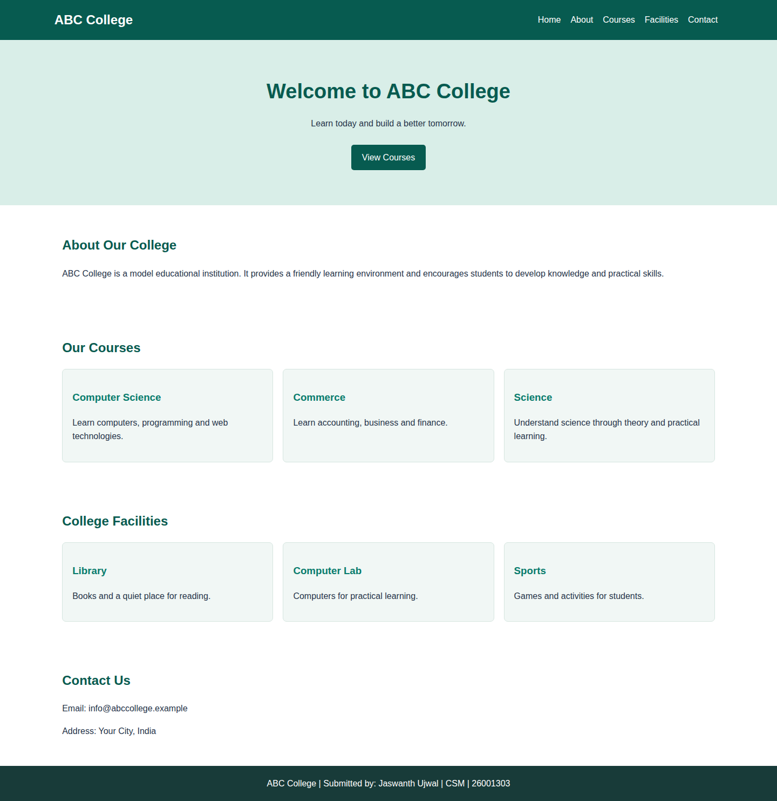
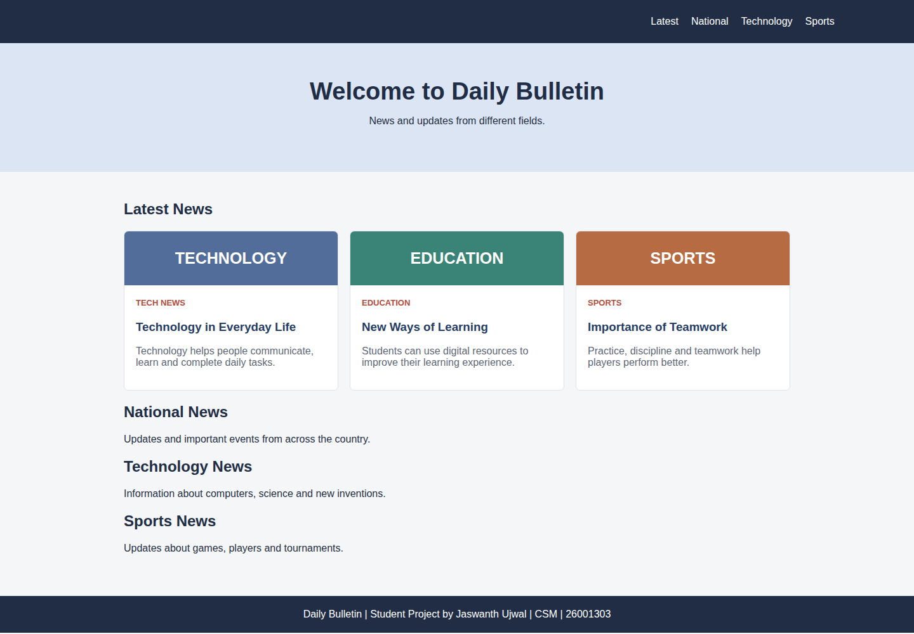

# Web Development ABL

## Student Details

- **Name:** Jaswanth Ujwal
- **Branch:** CSM
- **Roll No:** 26001303
- **Year:** B.Tech 1st Year

## Case Studies

1. Personal Portfolio Website
2. College Information Website
3. Online News Portal

## Technologies Used

- HTML
- CSS

Each case study contains a single `index.html` file. The pages use basic HTML and CSS concepts suitable for B.Tech 1st Year. No JavaScript is used.

## Output Screenshots

Screenshots are captured from the actual HTML pages in a browser using the GitHub Actions workflow.

### 1. Personal Portfolio Website

### 2. College Information Website

### 3. Online News Portal

